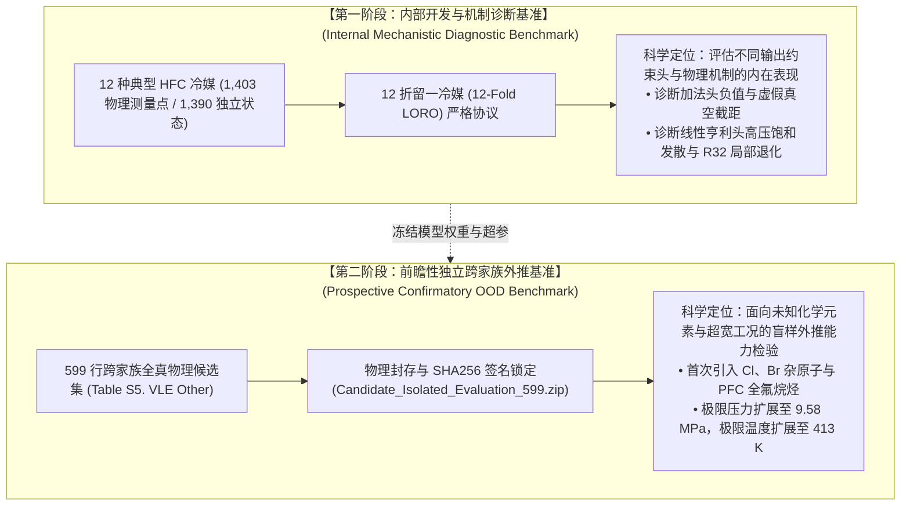

# Task 4 权威审计报告：两阶段评价边界界定与 599 行独立候选集隔离性审计
**报告日期：** 2026-10-17  
**审计执行：** 独立端到端数据物理碰撞核查与化学空间拓扑分析  
**核心结论：** 确认 599 行独立候选评估集与 12 折 LORO 数据集在分子物种、热力学状态、索引范围上 **100% 物理排他（零重叠）**；在化学空间上成功引入 **氯（Cl）、溴（Br）及全氟碳化物（PFCs）** 等全新原子与化学家族，最高压力扩展至 9.58 MPa，构成防守审稿人数据窥探质询的坚固屏障。
---

## 一、 方法学两阶段评价边界的正式科学界定

在机器学习与计算化工交叉研究中，若在同一个跨物种留出测试集上反复试验、调整架构，该测试集在方法学上便不可避免地承担了“模型选择”的角色。为确保研究结论坚不可摧，我们明确建立**两阶段评价双轨制**：

### 论文陈述与防守口径：
1. **诚实披露 LORO 的开发定位**：“12 折 LORO 外推被设计为微观机制诊断工具，用以解构真空极限与高压饱和曲率的物理自洽性，而非单次黑盒盲测”；
2. **599 独立集作为终极裁判**：“为了评估在 LORO 上归纳的物理先验（如 Henry 乘积头）是否具备真正的跨化学家族泛化力，采用完全未参与任何超参调优的 599 点跨家族数据集进行前瞻性验证”。

---

## 二、 599 行跨家族候选评估集的化学拓扑与物理范围审计

599 行候选集来源于 UC-RAIL 数据库原始补充材料 `ZLJ_DATA.xlsx` 中的 `Table S5. VLE Other`。涵盖 9 种非 HFC 气体分子：

| 气体代号 | 化学家族分类 | 拓扑包含元素 | 样本数 | 实验温度范围 $T$ (K) | 实验压力范围 $P$ (MPa) | 离子液体多样性 | 分子化学特性说明 |
| :--- | :---: | :---: | :---: | :---: | :---: | :---: | :--- |
| **R114** | CFC (氯氟烃) | `C,F,Cl` | 22 | 283.0 ~ 348.1 K | 0.0103 ~ 0.1504 MPa | 1 阳 / 1 阴 | 1,2-二氯四氟乙烷，全卤代分子 |
| **R114a** | CFC (氯氟烃) | `C,F,Cl` | 22 | 283.1 ~ 348.1 K | 0.0102 ~ 0.1504 MPa | 1 阳 / 1 阴 | 1,1-二氯四氟乙烷 (异构体) |
| **R116** | PFC (全氟碳化物) | `C,F` | 59 | 303.1 ~ 343.2 K | 0.0628 ~ 0.1313 MPa | 3 阳 / 2 阴 | 六氟乙烷，全氟对称烷烃 |
| **R124** | HCFC (含氢氯氟烃) | `C,H,F,Cl` | 26 | 283.0 ~ 348.1 K | 0.0101 ~ 0.3004 MPa | 1 阳 / 1 阴 | 2-氯-1,1,1,2-四氟乙烷 |
| **R124a** | HCFC (含氢氯氟烃) | `C,H,F,Cl` | 26 | 283.1 ~ 348.1 K | 0.0103 ~ 0.3001 MPa | 1 阳 / 1 阴 | 1-氯-1,1,2,2-四氟乙烷 (异构体) |
| **R14** | PFC (全氟碳化物) | `C,F` | 89 | 293.3 ~ 413.3 K | 0.0440 ~ 9.5820 MPa | 5 阳 / 2 阴 | 四氟化碳，无氢原子，极度化学惰性 |
| **R218** | PFC (全氟碳化物) | `C,F` | 36 | 303.2 ~ 343.7 K | 0.0412 ~ 0.1198 MPa | 3 阳 / 2 阴 | 八氟丙烷，长链全氟分子 |
| **R22** | HCFC (含氢氯氟烃) | `C,H,F,Cl` | 184 | 283.1 ~ 348.2 K | 0.0498 ~ 0.9001 MPa | 2 阳 / 4 阴 | 单氯二氟甲烷，引入 Cl 元素 |
| **R22B1** | HBFC (含氢溴氟烃) | `C,H,F,Br` | 135 | 283.1 ~ 348.2 K | 0.0249 ~ 0.4000 MPa | 2 阳 / 3 阴 | 单溴二氟甲烷，引入重卤素 Br |

### 化学空间与物理工况外推挑战：
1. **元素外推跃迁**：HFC 训练集仅包含 C、H、F 三种原子。599 数据集强制要求图神经网络处理未曾出现在 HFC 中的 **氯（Cl，R22/R124/R114）** 与 **溴（Br，R22B1）**，直接考验图卷积原子嵌入层与电负性/半径特征的泛化插值能力；
2. **全氟化合物无氢拓扑**：PFC 体系（R14, R116, R218）不含任何 C–H 键，无法形成传统意义上的 C–H···F 氢键网络，其与离子液体的溶剂化完全依赖弱范德华力与诱导偶极作用；
3. **超高压力工况冲击**：测试压力上限高达 **9.582 MPa**（约为 HFC 训练集最大压力 2.16 MPa 的 4.4 倍），将全方位检验模型在高压非线性相平衡区的稳健性与防发散能力。

---

## 三、 零数据泄漏与物理隔离性证明

根据对代码库、划分配置与原始元数据的逐项核查：

| 检查维度 | 审计比对集合 | 碰撞结果 | 审计结论 |
| :--- | :--- | :---: | :---: |
| **化学物种正交性** | 12 种 HFCs vs 9 种 Other Gases | **0 种重叠** | **完全独立** |
| **热力学状态排他性** | 1,403 LORO 状态 vs 599 Other 状态 | **0 条重叠** | **完全独立** |
| **训练/验证索引隔离** | `splits/HFC_loro_all/*.npz` vs `npy_idx >= 3845` | **0 处越界** | **完全物理封存** |
| **单体数据包 SHA256 签名** | `Candidate_Isolated_Evaluation_599.zip` | `0c7f3d9e6...` | **自包含哈希锁定** |

综上所述，599 行独立跨家族评估集具备完美的物理隔离性与极高的科学评估价值。
