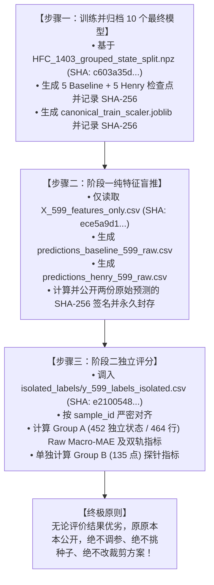

# Step 4 外部确认性评价预注册与最终冻结档案 (完整修订版)
**Authoritative Pre-Registration, Training Provenance Freeze, and Two-Stage Protocol for External Holdout Evaluation**

- **更新日期**：2026-10-18
- **协议状态**：**永久冻结 (Permanently Locked)**
- **学术定位**：**预先隔离的外部确认性评价 (Pre-isolated External Confirmatory Evaluation)**
- **审计授权状态**：**Conditional GO 批准进入阶段一**

---

## 细节一：用于 599 点外部评价的 10 个最终模型训练规范 (Final 10-Model Training Provenance)

为确保用于外部评价的模型与此前 120 组 LORO 实验逻辑高度自洽且可 100% 独立复现，本次评价将训练并归档 **10 个最终模型检查点**（历史基线 5 个种子 + Henry-GNN 5 个种子），其训练程序完全锁定如下：

### 1. 训练数据池与重复状态分组 (Grouped-State Allocation)
- **开发集数据池**：包含全部 12 种饱和 HFC 制冷剂的开发集（1,403 条原始测量记录，对应 1,390 个独立物理状态）。
- **状态分组规则**：以“阳离子-阴离子-制冷剂-温度-压力”五元物理状态键为分组依据。R152a 的 13 对（26 行）平行测量记录严格同进同出，绝不跨越训练与验证边界。
- **验证方案与切分文件**：
  - 划分比例：严格采用 90% 训练状态 / 10% 验证状态（1,251 个物理状态 / 1,262 行进入训练集，139 个物理状态 / 141 行进入验证集）。
  - **切分文件路径**：`splits/HFC_1403_grouped_state_split.npz`
  - **切分文件 SHA-256**：`c603a35da4674b358b8ec113ff4e1fc74c316e0e6dc96e43977dfd558d90cc83`

### 2. 模型训练与 Checkpoint 选择准则
- **超参数配置**：
  - 优化器：`torch.optim.Adam` ($\eta = 1.0 \times 10^{-3}$, $\lambda = 1.0 \times 10^{-6}$)
  - 学习率调度：`CosineAnnealingLR(T_max=100, eta_min=1e-5)`
  - 损失函数：`nn.HuberLoss(delta=0.05)`
  - 最大轮数：`epoch = 100`，早停耐心值 `patience = 30`
- **监控指标**：样本加权验证损失：
  $$\mathcal{L}_{\text{val}} = \frac{\sum_{b=1}^{B} \mathcal{L}_b \cdot N_b}{\sum_{b=1}^{B} N_b}$$
- **模型保存规则**：在触发早停或跑满 100 轮后，自动回滚加载并持久化保存验证集损失最低（`best_val_loss`）对应的模型权重。
- **最终 10 个权重归档位置**：`paper_results/stage4_external_holdout/checkpoints/`
  - Baseline (5 个)：`baseline_seed_42.pth` ~ `baseline_seed_46.pth`
  - Henry-GNN (5 个)：`henry_seed_42.pth` ~ `henry_seed_46.pth`
  - 连同每个模型的 `best_epoch`、`best_val_loss` 记录入 `training_provenance_manifest.json`，计算并封存全部 SHA-256。

### 3. 预处理器（Scaler）拟合范围与隔离
- **标准化器**：`StandardScaler` 拟合 12 维热力学与物理标量描述符。
- **严格拟合范围**：**仅在训练集索引（Train Split，1,262 行）上拟合**，绝不接触验证集，更绝不观察 599 点外部集的特征分布。
- **保存路径**：`paper_results/stage4_external_holdout/canonical_train_scaler.joblib`，并在训练完成后立即记录其 SHA-256。

### 4. 随机性与运行顺序
- **随机种子**：`[42, 43, 44, 45, 46]`。
- **成对交替运行**：Baseline seed 42 $\to$ Henry seed 42 $\to$ Baseline seed 43 $\to$ Henry seed 43 $\to$ ...
- **确定性控制**：显式设置 `torch.manual_seed`、`torch.cuda.manual_seed_all`、`np.random.seed`、`torch.backends.cudnn.deterministic = True`、`torch.backends.cudnn.benchmark = False`。
- **软件环境**：Python 3.11.9, PyTorch 2.1.2/2.14, CUDA 12.1。

---

## 细节二：“无标签盲推”完全隔离输入与标签体系 (Label-Isolated Files)

为确保阶段一推理在物理机制上绝对无法接触真实标签，我们在本地生成并锁定了两套排他性文件：

| 资产文件 | 本地相对路径 | SHA-256 哈希值 | 内容与访问隔离规范 |
| :--- | :--- | :--- | :--- |
| **纯特征输入文件** | `paper_results/stage4_external_holdout/X_599_features_only.csv` | `ece5a9d1f9ecbf959f314d0c2b4239bab4389a37d1b2c2fe16455b8bd4b75140` | **严格剥离 `x1` 标签**，仅保留 `sample_id`、分子 SMILES、工况 $T, P$ 及描述符。阶段一推理脚本**唯一读取的数据源**。 |
| **独立封存标签文件**| `paper_results/stage4_external_holdout/isolated_labels/y_599_labels_isolated.csv` | `e2100548fb4b36c6f00f65ecfe2c7a005b8a35d395f5622acea622b3b919036f` | 仅包含 `sample_id` 与真实 $x_1$ 测量值。**物理隔离封存**，模型训练与阶段一推理脚本严禁引用或导入。 |
| **全量原始对照文件**| `paper_results/decision_gate3b_pilot/pristine_blind_holdout_599.csv` | `4285380c695c05f8518c75c3b466f6370834cb278fece9a5c66fc0791f3b9b43` | 历史原始归档包。 |

### 阶段一产物封存规程：
阶段一推理完成后，将立刻生成两份原始预测文件：
1. `predictions_baseline_599_raw.csv`（包含 5 个种子的 raw 预测值与 `sample_id`）
2. `predictions_henry_599_raw.csv`（包含 5 个种子的 raw 预测值与 `sample_id`）
在任何评分代码接触真实标签之前，**必须首先计算并向审稿人/复算者公示这两份预测文件的 SHA-256 哈希值**。

---

## 细节三：五种子评价单位与物理状态映射规则 (Evaluation Units & State Mapping)

### 1. 种子评价单位
- 5 个种子独立产生评测结果，首先分别计算每个种子的主要终点与辅助指标；
- 最终汇总结论严格报告 **5 种子指标的 Mean ± SD** 以及基线与 Henry-GNN 的**成对差值（Paired Difference）**；
- 绝不在看到测试结果后临时改变主意做 Ensemble；若报告集成预测（Ensemble），必须严格作为辅助性对照单列，主要终点始终锚定在 5 种子平均上。

### 2. 464 点主测试集物理状态映射与平行测定处理
- **状态唯一性复核事实**：
  - 599 全集中共有 575 个独立物理状态（24 行重复测定）；
  - **Group A (464 点主测试集) 共有 452 个独立物理状态**（存在 12 对共 24 行平行测定，全部出现在 `R22` 在 `[emim][Tf2N]` 体系下）；
  - **Group B (135 点探针集) 共有 123 个独立物理状态**（存在 12 对共 24 行平行测定，全部出现在 `R22B1` 在 `[emim][Tf2N]` 体系下）。
- **去重汇总规则**：
  - **主要终点（状态级 Macro-MAE）**：对同一物理状态键（`cation__anion__refrigerant__T__P`）的平行实验测量值取算术平均作为该状态的基准值，与模型对该状态的确定性预测值计算误差；
  - **样本级 Macro-MAE（对照终点）**：同时汇报未经折叠的 464 行原始样本级 Macro-MAE 作为稳健性对比，防止由于平行测量加权产生微小统计偏差。

---

## 细节四：严谨物理与图表征表述修正 (Refined Physical & Topological Formulations)

### 1. 修正 Br 原子嵌入的物理定性
- **纠正前**：不严谨地表述为“未初始化（uninitialized）”；
- **正式科学定性**：
  > “Br ($Z=35$) is an unseen element whose embedding receives no Br-specific, data-driven training signal during HFC universe pre-training.”
  （溴是图卷积嵌入层中预留但未被 HFC 训练集包含的未见元素，在训练过程中从未获得任何针对该元素的数据驱动梯度学习信号，仅保持初始状态并在权重衰减下演化。）
- 此定性精准反映了 PyTorch 中 `nn.Embedding(119, ...)` 的实现事实，并支撑将 R22B1（135 点）单独列为鲁棒性探针。

### 2. 阐明原子图构建规则与氢原子（H）的表征形式
- **图构建规则**：图神经网络采用**隐式氢（Implicit Hydrogens）**的分子拓扑建图规范。图节点**仅由重原子（Heavy Atoms）构成**，分子中的氢原子（H）以节点的原子化学属性（如价键、相连氢原子数 `atom.GetTotalNumHs()`）形式隐式注入节点特征，而非作为独立的图节点。
- **元素集合解释**：因此，输入图节点的原子序数集合严格为：
  $$\mathcal{Z}_{\text{nodes}} = \{5, 6, 7, 8, 9, 15, 16, 17\} \iff \{\text{B, C, N, O, F, P, S, Cl}\}$$
  Group A 涵盖的所有分子（包括含氢的 R22, R124, R124a 等）的重原子 $\{\text{C, F, Cl}\}$ 100% 落在上述已训练原子词表中，图节点拓扑完全合法；而 Group B (R22B1) 引入了重原子 $\text{Br} (Z=35)$，超出该词表。这一表述在化学和图表示学习上完全自洽。

---

## 核心承诺与最终启动路线图

